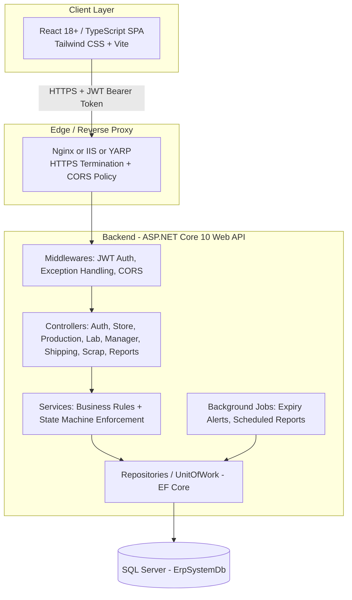
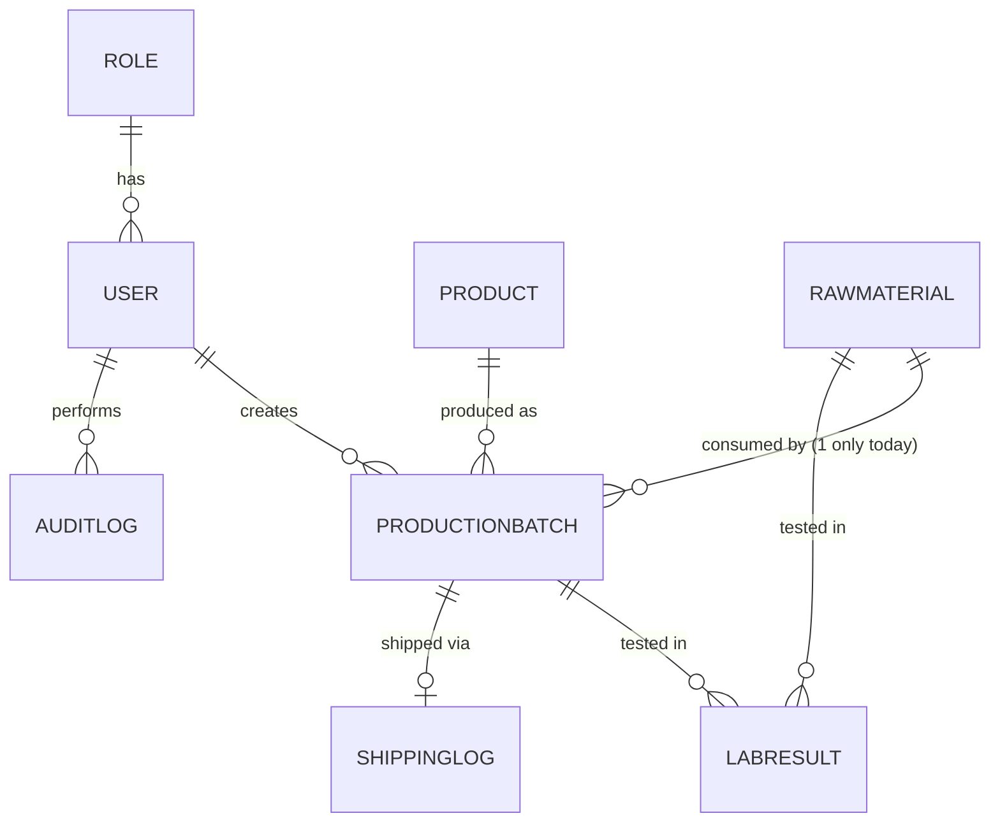
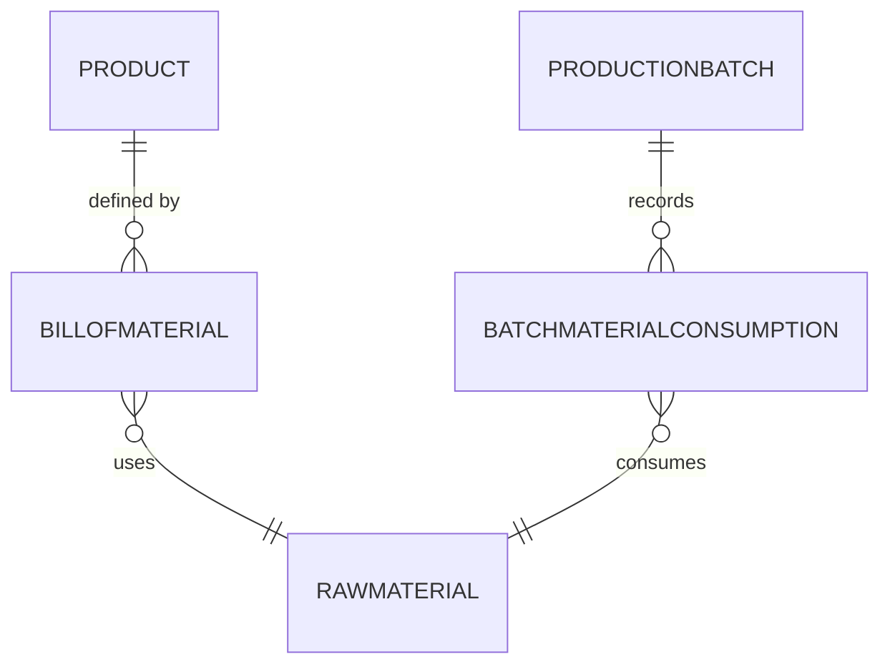
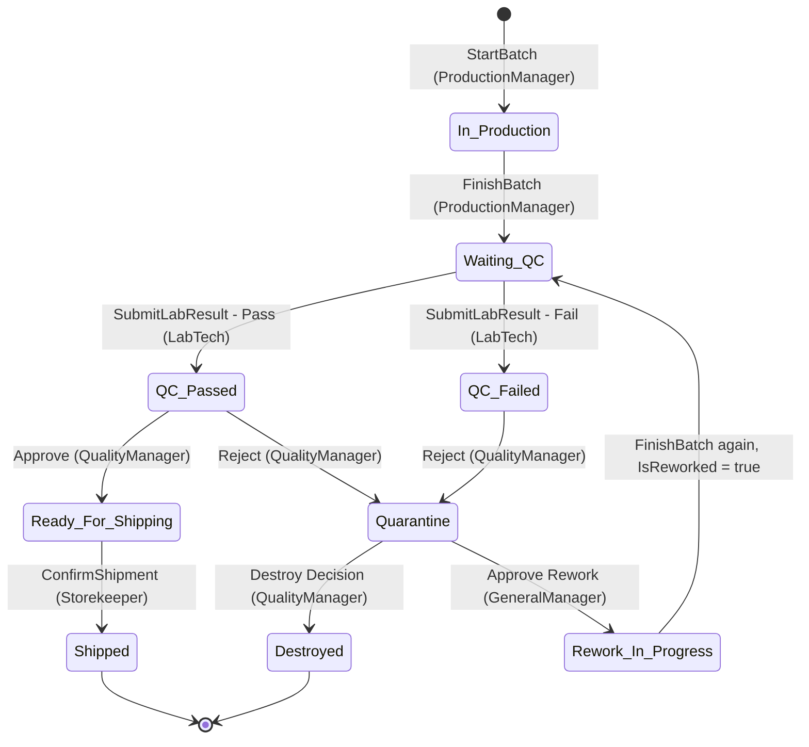

# التصميم المعماري الشامل — نظام إدارة الإنتاج وتتبع دورة الحياة (MES / Mini-ERP)

**تاريخ الإعداد:** 29 أغسطس 2026
**الحالة:** مبني على مراجعة كاملة للكود الفعلي المرفوع (Backend + Frontend + مستندات المتطلبات)، وليس مجرد قالب عام.
**Stack المستهدف:** Backend = C# / ASP.NET Core (.NET 10) — Frontend = React + TypeScript + Tailwind CSS — Data = SQL Server (EF Core)

---

## 0. ملخص تنفيذي

النظام عبارة عن **MES (Manufacturing Execution System) / Mini-ERP** لتتبع دورة حياة الإنتاج بالكامل: من استلام الخامة، مرورًا بالتصنيع والفحص المعملي وموافقة الإدارة، وحتى الشحن للعميل — مع نظام عزل وإتلاف/إعادة تدوير للمرفوض، وسجل تتبع (Audit Trail) شامل لا يُحذف منه شيء.

بعد مراجعة كل الملفات المرفوعة (2 مستند متطلبات، مستند رؤية تفاعلي، والكود الكامل داخل الأرشيف)، الصورة الحقيقية للمشروع هي:

| الطبقة | الحالة الفعلية اليوم |
|---|---|
| **Backend (C#/.NET)** | مبني فعليًا بنسبة تُقارب 85% من المواصفة الأساسية. البنية (Controllers → Services → Repositories → EF Core) سليمة ومطبّقة بانضباط، ومنطق آلة الحالات (State Machine) منفّذ بشكل صحيح في أغلب الحالات. توجد ثغرات ونقاط تحتاج إصلاح مذكورة بالتفصيل في القسم 5.11. |
| **Data (SQL Server)** | قاعدة البيانات مُنشأة بالفعل عبر EF Core Migrations (SQL Server، وليست SQLite أو غيرها)، والجداول الأساسية مطابقة تقريبًا لمستند المتطلبات. تحتاج توسعة لدعم "وصفة الإنتاج" (BOM) وتطبيع بيانات الموردين/العملاء. |
| **Frontend** | **لم يُبنَ فعليًا بعد.** الملفات الموجودة (`index.html`, `dashboard.html`, `lab.html`, `production.html`, `store.html`, `api.js`, `auth.js`, `main.css`) هي ملفات قوالب فارغة تلقائية من Visual Studio (لم يُكتب فيها كود حقيقي). هذا يعني أن الفرونت **مشروع جديد بالكامل (Greenfield)** ولا يوجد "ترحيل" حقيقي مطلوب — وهذا خبر جيد، لأنه يعطينا حرية كاملة لبنائه من الصفر بـ React + TypeScript + Tailwind دون قيود من كود قديم. |
| **المستندات** | يوجد مستند متطلبات نظيف وكامل (`erp_system_requirements.txt`)، ونسخة منه بها تلف في الترميز (`erp_system.md` — النص العربي محفوظ بترتيب حروف معكوس بسبب مشكلة نسخ/تحويل، ولا يُنصح بالاعتماد عليه)، ومستند HTML تفاعلي (`index.html` في المرفقات) يحتوي على خارطة طريق مقسّمة لـ 5 طبقات كانت الخطة الأصلية للفرونت فيه **Vanilla JS** — وهذا ما تم تغييره الآن رسميًا إلى **React + TypeScript + Tailwind** بناءً على طلبك، وهو ما يعكسه هذا المستند. |

هذا المستند هو المرجع المعماري الكامل: يوثّق ما هو قائم فعليًا، ويحدد بدقة ما يجب تعديله أو إضافته، ويضع تصميم الفرونت الجديد بالكامل، بحيث يكون النظام **قابلًا للتوسع (Scalable)** و**قابلًا للصيانة (Maintainable)** على المدى الطويل.

---

## 1. المبادئ المعمارية الحاكمة (Non-Negotiable Rules)

هذه المبادئ موجودة أصلًا في مستند المتطلبات الخاص بك، وتم التحقق من أنها مطبّقة فعليًا في الكود بنسبة كبيرة. أي تطوير مستقبلي (فرونت أو باك) **يجب** أن يلتزم بها:

1. **الـ Backend هو مصدر الحقيقة الوحيد (Single Source of Truth):** الفرونت لا يقرر شيئًا — لا صلاحية ولا حالة. كل تحقق (Validation) يحدث داخل الـ Backend قبل لمس قاعدة البيانات. الفرونت "يعرض ويُخفي" فقط (UI Muting)، ولا يُعتمد عليه كطبقة حماية.
2. **آلة حالات صارمة (Strict State Machine):** كل كيان له حالة (`CurrentState`) لا يمكن أن يقفز بين الحالات؛ يجب المرور بالتسلسل المنطقي، والـ Backend يرفض أي طلب لا يطابق الحالة الحالية.
3. **العمليات الذرية (Atomic DB Transactions):** أي عملية تُعدّل أكثر من جدول (خصم من مكان + إضافة في مكان + تسجيل Audit) يجب أن تُحفظ في نفس الـ Transaction، بحيث لو فشل السيرفر منتصف العملية لا تُفقد بيانات ولا يحدث تعارض.
4. **سجل تتبع شامل لا يُحذف منه شيء (Immutable Audit Trail):** كل Action له بصمة كاملة: من نفّذه، متى، على أي مرجع، وبأي حالة فيزيائية للمادة.

---

## 2. المخطط المعماري العام (High-Level Architecture)



**الفكرة الأساسية:** طبقات مفصولة بوضوح، كل طبقة لا "تعرف" تفاصيل الطبقة التي تحتها إلا عبر واجهة (Interface). هذا هو ما يجعل النظام قابلًا للتوسع لاحقًا (تقدر تستبدل SQL Server بحاجة تانية نظريًا، أو تضيف قناة عرض جديدة (تطبيق موبايل مثلًا) دون ما تلمس منطق الأعمال).

---

## 3. طبقة البيانات (SQL Server / EF Core)

### 3.1 الجداول الحالية (كما هي منفّذة فعليًا في الكود)

| الجدول | أهم الأعمدة | ملاحظات |
|---|---|---|
| `Roles` | `Id`, `RoleName` | 6 أدوار فعلية في الكود: `SuperAdmin`, `Storekeeper`, `ProductionManager`, `LabTech`, `QualityManager`, `GeneralManager` |
| `Users` | `Id`, `FullName`, `Username`, `PasswordHash`, `RoleId`, `IsActive`, `CreatedAt` | تشفير الباسورد عبر `PasswordHasher<T>` من ASP.NET Identity — ممارسة سليمة وآمنة |
| `RawMaterials` | `Id`, `MaterialName`, `SupplierName`, `CurrentQuantity`, `PhysicalState`, `ExpiryDate`, `IsQCApproved` | `SupplierName` نص حر وليس FK لجدول موردين |
| `Products` | `Id`, `ProductName`, `SKU` | جدول بسيط جدًا حاليًا — لا يحمل وصفة تصنيع (BOM) |
| `ProductionBatches` | `Id`, `BatchNumber`, `ProductId`, `RawMaterialId`, `IssuedMaterialQty`, `ProducedQty`, `ReturnedMaterialQty`, `ScrapQty`, `CurrentState`, `IsReworked`, `ExpiryDate`, `CreatedBy`, `CreatedAt` | **خامة واحدة فقط لكل تشغيلة** (قيد مهم، انظر 3.3) |
| `LabResults` | `Id`, `Type`, `BatchId?`, `RawMaterialId?`, `ResultDetails`, `IsPassed`, `Notes`, `TestedBy`, `TestedAt` | مرجع اختياري لباتش أو خامة (Nullable FK) — نمط جيد وسليم |
| `ScrapAndQuarantines` | `Id`, `SourceType`, `ReferenceId`, `Quantity`, `ScrapReason`, `FinalDecision`, `DecisionBy`, `CreatedAt` | `ReferenceId` مرجع "متعدد الأشكال" غير مرتبط بـ FK حقيقي (انظر 3.3) |
| `ShippingLogs` | `Id`, `BatchId`, `ClientName`, `DriverName`, `TruckPlates`, `ShippedBy`, `ShippingDate` | `ClientName` نص حر وليس FK لجدول عملاء |
| `AuditLogs` | `Id`, `UserId`, `Action`, `Details`, `Timestamp` | أقل تفصيلًا من المواصفة الأصلية (انظر 3.3) |

### 3.2 مخطط العلاقات الحالي



### 3.3 التوسعات المطلوبة على قاعدة البيانات (لتحقيق "قابل للتوسع")

هذه أهم نقطة يجب البدء بها قبل أي تطوير آخر، لأنها تمس شكل البيانات نفسه:

**أ) دعم وصفة الإنتاج المتعددة المكونات (Bill of Materials)**
اليوم `ProductionBatch` مربوط بـ `RawMaterialId` واحد فقط. أي منتج حقيقي يحتاج عادة أكثر من خامة. الحل المقترح (متوافق للخلف):



- `BillOfMaterials (Id, ProductId, RawMaterialId, RequiredQtyPerUnit)` — الوصفة القياسية للمنتج.
- `BatchMaterialConsumption (Id, ProductionBatchId, RawMaterialId, IssuedQty, ReturnedQty, ScrapQty)` — الاستهلاك الفعلي لكل خامة داخل تشغيلة معينة (بديل عمود `RawMaterialId` المفرد على `ProductionBatch`).
- يبقى عمود `ProductionBatch.RawMaterialId` القديم مؤقتًا (Deprecated) أثناء فترة الانتقال، ثم يُحذف بعد ترحيل البيانات.

**ب) تطبيع الموردين والعملاء**
- إضافة جدول `Suppliers (Id, Name, ContactInfo, ...)` وربطه بـ `RawMaterials.SupplierId`.
- إضافة جدول `Customers (Id, Name, ContactInfo, ...)` وربطه بـ `ShippingLogs.CustomerId`.
- الفائدة: تقارير حسب المورد/العميل، ومنع أخطاء كتابة الاسم يدويًا في كل مرة.

**ج) إعادة هيكلة `AuditLogs` لتطابق المواصفة الأصلية بالكامل**
المواصفة تطلب حقولًا منفصلة: `ActionType`, `ReferenceType`, `ReferenceValue`, `MaterialPhysicalState`, `Notes` — لكن التنفيذ الحالي يدمجها كلها في عمود نصي واحد (`Details`). هذا يمنع الفلترة والبحث السريع (يحتاج `LIKE` بدل مطابقة مباشرة). المقترح:

```
AuditLogs (
  Id, UserId, ActionType, ReferenceType, ReferenceId, ReferenceValue,
  MaterialPhysicalState NULL, Notes NULL, CreatedAtUtc
)
```
مع فهرس مركّب على `(ReferenceType, ReferenceId)` لتسريع شاشة التتبع (Traceability) الخاصة بالمدير العام.

**د) توحيد جدول الهالك فعليًا كجدول مركزي واحد**
المواصفة تنص صراحة: *"جدول مركزي لتسجيل أي هالك من أي قسم"*. لكن هالك خط الإنتاج (`ProductionBatch.ScrapQty`) لا يُسجَّل حاليًا كسطر في `ScrapAndQuarantines` — بل يبقى رقمًا على التشغيلة نفسها. المقترح: أي هالك (من المخزن، من الإنتاج، أو رفض المدير) يُنشئ دائمًا سطرًا في `ScrapAndQuarantines`، مع استبدال `ReferenceId + SourceType` (مرجع متعدد الأشكال بلا FK حقيقي) بحقلين صريحين:

```
ScrapAndQuarantines (
  ..., SourceType, RawMaterialId NULL (FK), ProductionBatchId NULL (FK), ...
)
```
بحيث يكون أحدهما فقط ممتلئًا (Check Constraint)، ويصبح ربط EF Core بـ `.Include()` ممكنًا بدل الجلب اليدوي.

**هـ) إضافة عمود `CurrentState` صريح على `RawMaterial`**
اليوم الحالة "ضمنية" عبر `IsQCApproved` (Boolean) فقط. مقترح: `CurrentState: Pending_QC | Approved_Available | Fully_Issued | Rejected` لتتوافق مع نفس نمط `ProductionBatch`، ولتسهيل شاشة تتبع موحدة لاحقًا.

**و) قيود سلامة إضافية**
- فهرس **Unique** على `Users.Username` و`ProductionBatches.BatchNumber` (غير موجودين حاليًا في الـ Migration — الاعتماد فقط على تحقق منطقي في الكود يفتح الباب لتعارض تحت الضغط/التزامن).
- عمود **RowVersion** (Concurrency Token) على `RawMaterial` و`ProductionBatch` لمنع تعارض تحديث الكميات عند طلبين متزامنين (انظر 5.11 للتفصيل).
- تحويل كل `DateTime.Now` إلى `DateTime.UtcNow` في كل الموديلات (توحيد المنطقة الزمنية، ضروري لو السيرفر تغيّر موقعه أو تعدد النسخ مستقبلًا).

### 3.4 آلة حالات التشغيلة (Production Batch State Machine) — المرجع الكامل



جدول مرجعي كامل (يبقى صحيحًا بغض النظر عن أداة العرض المستخدمة):

| من الحالة | الفعل | إلى الحالة | من ينفّذه | Endpoint |
|---|---|---|---|---|
| — | بدء تشغيلة | `In_Production` | ProductionManager | `POST /api/production/start-batch` |
| `In_Production` / `Rework_In_Progress` | إنهاء وطلب فحص | `Waiting_QC` | ProductionManager | `POST /api/production/finish-batch` |
| `Waiting_QC` | نتيجة معمل ناجحة | `QC_Passed` | LabTech | `POST /api/lab/submit-result` |
| `Waiting_QC` | نتيجة معمل راسبة | `QC_Failed` | LabTech | `POST /api/lab/submit-result` |
| `QC_Passed` | موافقة المدير | `Ready_For_Shipping` | QualityManager | `POST /api/manager/decision` |
| `QC_Passed` أو `QC_Failed` | رفض المدير | `Quarantine` | QualityManager | `POST /api/manager/decision` |
| `Ready_For_Shipping` | تأكيد شحن | `Shipped` | Storekeeper | `POST /api/shipping/create` |
| `Quarantine` | قرار إعدام | `Destroyed`* | QualityManager | `POST /api/scrap/quality-decision` |
| `Quarantine` | موافقة إعادة تدوير | `Rework_In_Progress` | GeneralManager | `POST /api/scrap/approve-rework/{id}` |

*"`Destroyed`" هنا هي الحالة **المُوصى بها** كهدف تصميمي؛ الكود الحالي يسجّلها فقط في `ScrapAndQuarantine.FinalDecision` دون تحديث `ProductionBatch.CurrentState` — هذه فجوة موثقة في القسم 5.11 ويجب إغلاقها.

---

## 4. طبقة الـ Backend (C# / ASP.NET Core 10)

### 4.1 التقييم العام

البنية الحالية (`Controllers → Services (Business Logic + State Machine) → Repositories/UnitOfWork → EF Core`) هي بنية **طبقية سليمة ومناسبة تمامًا** لحجم هذا النظام — لا داعي لتعقيدها بـ CQRS أو Microservices في هذه المرحلة؛ ذلك سيكون إفراطًا هندسيًا (Over-engineering) غير مبرر لحجم الفريق والنطاق الحالي. التوصية: **تطوير نفس البنية وتقويتها**، وليس استبدالها.

### 4.2 هيكلة المجلدات المقترحة (تطوير على القائم)

```
ERP.Api/
├── Controllers/            (قائم - يُحافظ عليه)
├── Services/                (قائم - يُحافظ عليه)
│   └── Interfaces/          (جديد: فصل الـ Interfaces في مجلد فرعي)
├── Repositories/            (قائم)
├── Models/                  (قائم - + الكيانات الجديدة من القسم 3.3)
├── DTOs/                    (قائم - منظم بالفعل حسب الميزة، ممتاز)
├── Data/
│   ├── AppDbContext.cs
│   └── Seed/                (جديد: بيانات أولية - الأدوار + مستخدم SuperAdmin)
├── Migrations/               (قائم)
├── Middlewares/              (قائم - + معالجة استثناءات مطوّرة)
├── Common/                   (جديد)
│   ├── BaseApiController.cs  (استخراج GetCurrentUserId المكرر في كل Controller)
│   ├── ApiResponse.cs        (غلاف استجابة موحّد)
│   └── ClaimsPrincipalExtensions.cs
├── Exceptions/                (جديد: NotFoundException, BusinessRuleException, ConflictException)
├── Validators/                (جديد: FluentValidation، اختياري لكن يُنصح به)
├── BackgroundJobs/            (موجود فعليًا وفارغ - أول استخدام حقيقي له: تنبيهات انتهاء الصلاحية)
└── Program.cs
```

### 4.3 غلاف استجابة API موحّد (Standard Response Envelope)

اليوم كل Controller يرجّع Shape مختلف (`Ok(result)`, `Ok(new { message = "..." })`, `BadRequest(new { message = "..." })`). هذا يصعّب التعامل معه من فرونت TypeScript (كل Endpoint له نوع استجابة مختلف بلا نمط ثابت). المقترح:

```csharp
public class ApiResponse<T>
{
    public bool Success { get; set; }
    public T? Data { get; set; }
    public string? ErrorCode { get; set; }   // "BATCH_NOT_FOUND", "INVALID_STATE_TRANSITION"...
    public string? Message { get; set; }     // نص عربي قابل للعرض مباشرة
}
```

الفائدة المباشرة: الفرونت في React يقدر يعرّف نوع TypeScript عام `ApiResponse<T>` واحد، ويبني عليه كل الـ hooks، بدل التعامل مع Shape مختلف لكل Endpoint. كما تسمح `ErrorCode` للفرونت باتخاذ قرار برمجي (مثلاً: إخفاء زر معيّن) بدل تحليل نص الرسالة العربي.

### 4.4 معالجة الأخطاء

**القائم:** `ExceptionHandler` middleware يمسك أي استثناء غير متوقع، يُخفي التفاصيل في الإنتاج، ويسجّل عبر `ILogger`. هذا أساس جيد.

**المقترح للتطوير:** حاليًا كل قواعد العمل تُرجع `null`/`false` عند الفشل، والـ Controller يحوّلها يدويًا لرسالة عربية عامة — وهذا يفقد "السبب الحقيقي" للفشل. المقترح استخدام استثناءات مخصصة (`NotFoundException`, `InvalidStateTransitionException`, `ConflictException`) تُطلق من الـ Service، ويمسكها الـ Middleware المطوّر ليحوّلها تلقائيًا لكود HTTP الصحيح (404/409/400) وإلى `ApiResponse<T>` بـ `ErrorCode` مناسب — بدل أن يكون كل Controller مسؤولاً عن اختيار الرسالة يدويًا في كل حالة.

### 4.5 الأمان والصلاحيات (AuthN/AuthZ)

| الموجود اليوم | التقييم |
|---|---|
| JWT Bearer + `[Authorize(Roles = "...")]` على مستوى كل Endpoint | ✅ نمط سليم ومباشر |
| تشفير الباسورد عبر `PasswordHasher<T>` (PBKDF2) | ✅ ممارسة آمنة قياسية |
| صلاحية توكن 8 ساعات، بدون Refresh Token | ⚠️ مقبول لبيئة مصنع (شِفت عمل)، لكن لا يوجد إبطال فوري (Revocation) لو تغيّر دور المستخدم أو تم تعطيله أثناء الجلسة |

**توصيات للتطوير المستقبلي:**
- الانتقال إلى **Policy-Based Authorization** (`[Authorize(Policy = "CanApproveBatches")]`) بدل الاعتماد المباشر على أسماء الأدوار المكتوبة كنص في كل Controller — هذا يسهّل تغيير من يملك صلاحية معينة دون تعديل كل مكان مكرر بها اسم الدور.
- إضافة Refresh Token قصير الأجل + Access Token أقصر (مثلاً 30 دقيقة) إذا زاد حجم الفريق أو تطلب الأمر إبطال جلسات فورًا.
- **(أولوية حرجة، انظر 5.11)** مفتاح توقيع الـ JWT مكتوب حاليًا كنص صريح داخل `appsettings.json` — يجب نقله فورًا لمتغيرات بيئة (Environment Variables) أو Secrets Manager.

### 4.6 التحقق من صحة المدخلات (Validation)

القائم: `[Required]` على مستوى الـ DTOs — جيد كخط دفاع أول لكنه سطحي. التوصية: إضافة **FluentValidation** لقواعد أدق (مثل: `ProducedQty >= 0`, `IssuedMaterialQty > 0`) **مع الإبقاء على قواعد الأعمال الحرجة (مطابقة تسلسل الحالة، معادلة الهالك) داخل الـ Service Layer كما هي الآن** — لأن هذه قواعد أعمال حقيقية (Domain Rules) وليست مجرد تحقق شكلي من المدخلات (Input Validation)، والفصل بينهما مبدأ معماري سليم يجب الحفاظ عليه.

### 4.7 التسجيل والمراقبة (Logging & Observability)

اليوم لا يوجد `ILogger` مُستخدَم داخل أي Service — فقط الـ AuditLog (وهو سجل أعمال/Compliance، وليس سجل تشغيلي/Diagnostic). التوصية: فصل الاثنين بوضوح:
- **AuditLog** (قائم): "من فعل ماذا ومتى" — للمراجعة والامتثال، لا يُحذف أبدًا.
- **Structured Application Logging** (جديد، مقترح: **Serilog**): "هل الأداء طبيعي؟ هل توجد أخطاء متكررة؟" — لأغراض التشغيل والصيانة، مع إمكانية إرساله لاحقًا لأداة مركزية (Seq / Application Insights / ELK) عند التوسع.
- إضافة Endpoint بسيط للفحص الصحي (`/health`) — ضروري لأي بيئة نشر حقيقية (Load Balancer / Container Orchestration مستقبلًا).

### 4.8 المهام الخلفية وقابلية التوسع (Background Jobs & Scalability)

مجلد `BackgroundJobs/` موجود في المشروع بالفعل لكنه **فارغ تمامًا** — وهذا يشير إلى أنه كان مخططًا له من البداية. أول استخدام طبيعي له:
- **تنبيه انتهاء الصلاحية:** فحص دوري (يوميًا) لأي `RawMaterial` أو `ProductionBatch` قريب من `ExpiryDate` وتنبيه الأقسام المعنية.
- تنفيذ ذلك عبر `IHostedService` / `BackgroundService` المدمجة في .NET، أو **Hangfire** لو احتجتم جدولة أكثر مرونة ولوحة متابعة للمهام.

بخصوص التوسع الأفقي: الـ API عديم الحالة (Stateless) بفضل JWT — هذا يعني أنه **جاهز للتوسع الأفقي (Horizontal Scaling)** من اليوم الأول (تشغيل أكثر من نسخة خلف Load Balancer) دون أي تعديل، بشرط عدم تخزين أي حالة داخل الذاكرة المحلية للسيرفر (وهو ما لا يحدث حاليًا في الكود — نقطة إيجابية).

### 4.9 الأداء وتقليل عدد الاستعلامات

- **الترقيم (Pagination):** كل نقاط `GetAll*` (Batches, Materials, Shipments, ScrapEntries) تُرجع القائمة كاملة بلا حدود — مقبول في بداية المشروع، لكنه **لن يتحمّل التوسع** بعد أشهر من التشغيل الفعلي. التوصية: إضافة `?page=1&pageSize=20` كمعيار قياسي على كل Endpoint من هذا النوع.
- **حل مشكلة N+1:** `GenericRepository<T>` الحالي لا يدعم `.Include()` إطلاقًا؛ ولذلك تلجأ `ReportsService.BuildTraceabilityDto` لجلب كل كيان مرتبط بطلب منفصل (Material، User، LabResults، Shipment...) بدل استعلام واحد بـ Join. التوصية: إضافة overload لـ `GetByIdAsync`/`FindAsync` يقبل `params Expression<Func<T,object>>[] includes`، أو الانتقال لطلبات Projection مباشرة (`Select()`) للتقارير الثقيلة.
- **تجميع لوحة المعلومات:** `GetDashboardStatsAsync` يجلب **كل** التشغيلات وكل سطور الهالك للذاكرة ثم يَعُدّ بـ LINQ — يجب دفع هذا التجميع (`COUNT`, `SUM`, `GROUP BY`) إلى قاعدة البيانات نفسها بدل تحميله بالكامل في الذاكرة، خصوصًا مع نمو البيانات بمرور الوقت.

### 4.10 التوثيق والإصدار

Swagger/OpenAPI مُفعّل بالفعل ✅ (نقطة قوة كبيرة — سنستفيد منها مباشرة في توليد أنواع TypeScript للفرونت، انظر 5.3). التوصية الإضافية: إضافة **API Versioning** (`/api/v1/...`) من الآن، حتى لو نسخة واحدة فقط اليوم — هذا يوفر مساحة تعديل مستقبلية دون كسر الفرونت القائم لاحقًا.

### 4.11 ملاحظات فحص دقيقة (Findings من المراجعة الفعلية للكود)

هذه نقاط محددة اكتُشفت بالمراجعة السطر-بسطر للكود المرفوع، مرتّبة حسب الأولوية:

| # | الأولوية | الملاحظة | التوصية |
|---|---|---|---|
| 1 | 🔴 حرجة | **مفتاح توقيع الـ JWT مكتوب صراحة كنص واضح (Plaintext) داخل `appsettings.json`** بدل أن يُقرأ من متغير بيئة أو مخزن أسرار. وبمراجعة `.gitignore`، يتضح أنه كان يُفترض استبعاد ملف الأسرار من Git، لكن الاستبعاد وقع فعليًا على `appsettings.Development.json` (وهو لا يحتوي على أي سر) بينما **الملف الفعلي الذي يحمل السر (`appsettings.json`) غير مُستبعد** ويُرفع لمستودع الكود. | تدوير المفتاح فورًا، نقله لمتغيرات بيئة أو Secrets Manager (Azure Key Vault / AWS Secrets Manager)، واستخدام `dotnet user-secrets` للتطوير المحلي. |
| 2 | 🔴 حرجة | **لا يوجد إعداد CORS إطلاقًا** في `Program.cs`. أي طلب من فرونت React (على origin/port مختلف) سيُرفض من المتصفح مباشرة. | إضافة `AddCors` بسياسة مسماة تسمح بـ origin الفرونت (Dev: `http://localhost:5173` لو Vite، Prod: الدومين الفعلي). **يجب إنجاز هذا قبل بدء ربط React بالـ API.** |
| 3 | 🟠 عالية | `app.UseHttpsRedirection()` **معطّل (Commented Out)** في `Program.cs`. | تفعيله في كل بيئة ما عدا التطوير المحلي البحت. |
| 4 | 🟠 عالية | في `StoreService.AddRawMaterialAsync` و`ProductionService.StartBatchAsync`: استدعاء `SaveChangesAsync()` **مرتين منفصلتين** (مرة لحفظ الكيان، ومرة بعد تسجيل الـ Audit) رغم أن الـ Audit في الحالتين يستخدم `MaterialName`/`BatchNumber` (مش الـ `Id` المولّد من القاعدة) — أي أن الحفظ المزدوج غير ضروري فعليًا، ويكسر مبدأ "العملية الذرية الواحدة" المذكور في المتطلبات نفسها. | دمجهما في `SaveChangesAsync()` واحدة، مطابقةً لبقية الـ Services (`FinishBatchAsync`, `IssueMaterialAsync`... إلخ التي تعمل بشكل صحيح بالفعل). |
| 5 | 🟠 عالية | **لا يوجد Optimistic Concurrency** على `RawMaterial.CurrentQuantity`. طلبان متزامنان لصرف نفس الخامة (Read-Check-Write بدون قفل) قد يؤديان لكمية سالبة أو صرف أكبر من المتاح فعليًا (Race Condition كلاسيكي). | إضافة عمود `RowVersion` (Concurrency Token)، أو استخدام تحديث SQL ذري (`UPDATE ... WHERE CurrentQuantity >= @qty`) مع فحص عدد الصفوف المتأثرة. |
| 6 | 🟡 متوسطة | **فجوة منطقية بين `ScrapService` و`ProductionBatch.CurrentState`:** عند اتخاذ قرار "إعدام" (`Destroy`) على سطر في `ScrapAndQuarantine`، يتحدّث `FinalDecision` فقط إلى `"Destroyed"`، لكن `ProductionBatch.CurrentState` **يبقى `"Quarantine"` للأبد** ولا يتحدّث لحالة نهائية. هذا يجعل عدّاد `QuarantineCount` في لوحة المدير العام مُبالَغًا فيه لأنه يحسب تشغيلات تم إعدامها فعليًا. | تحديث `ProductionBatch.CurrentState` إلى `"Destroyed"` أيضًا داخل نفس العملية، أو تعديل استعلام `GetDashboardStatsAsync` ليستثني التشغيلات المرتبطة بقرار حاسم بالفعل. |
| 7 | 🟡 متوسطة | لا يوجد فهرس **Unique** على `Users.Username` ولا `ProductionBatches.BatchNumber` على مستوى قاعدة البيانات — الاعتماد فقط على تحقق منطقي بالكود. | إضافة `IsUnique()` على العمودين عبر `OnModelCreating` + Migration جديدة. |
| 8 | 🟡 متوسطة | هالك خط الإنتاج (`ProductionBatch.ScrapQty`) لا يُنشئ سطرًا في `ScrapAndQuarantines` — يخالف نص المتطلبات: *"جدول مركزي لتسجيل أي هالك من أي قسم"*. | عند `FinishBatchAsync`، إن كان `scrap > 0`، إنشاء سطر `ScrapAndQuarantine` بـ `SourceType = "ProductionLine"` تلقائيًا. |
| 9 | 🟢 منخفضة | `NoWarn: NU1903` في ملف الـ `.csproj` — هذا يُسكت تحذير NuGet الخاص بوجود ثغرة أمنية معروفة (Known Vulnerability) في حزمة ما، بدل معالجتها. | مراجعة أي حزمة تسببت في التحذير والتحقق من توفر نسخة مُصلَحة، بدل إخفاء التحذير بالكامل. |
| 10 | 🟢 منخفضة | `DTOs/MappingProfile.cs` ملف فارغ تمامًا، ولا يوجد مرجع لحزمة AutoMapper في المشروع أصلًا — أي أنه ملف متبقٍّ (Dead Scaffolding) بينما كل الـ Mapping الفعلي يتم يدويًا (`MapToDto`) في كل Service. | إما حذف الملف (بما أن التعيين اليدوي يعمل بشكل جيد وواضح)، أو تفعيل AutoMapper فعليًا إن رغبتم بتوحيد الأسلوب. |
| 11 | 🟢 منخفضة | كل الـ Controllers (7 ملفات) تكرر نفس الدالة الخاصة `GetCurrentUserId()` حرفيًا. | استخراجها إلى `BaseApiController` مشترك أو `ClaimsPrincipal` Extension Method واحد. |
| 12 | 🟢 منخفضة | استخدام `DateTime.Now` بدل `DateTime.UtcNow` في كل مكان (الموديلات، توقيت انتهاء التوكن). | التوحيد على UTC في التخزين، وتحويل العرض للتوقيت المحلي في الفرونت فقط. |

> **ملحوظة إنصاف:** رغم القائمة أعلاه، الأساس المعماري الحالي **قوي وسليم فعليًا** — الفصل بين الطبقات واضح، منطق آلة الحالات مطبّق بدقة تُحسب لصاحب الكود، ومعادلة حساب الهالك ("العادلة الذهبية" كما وُصفت في التعليقات) محسوبة في نقطة واحدة فقط بشكل صحيح. القائمة أعلاه تحسينات وتصليحات على أساس جيد، وليست إعادة بناء من الصفر.

---

## 5. طبقة الـ Frontend (React + TypeScript + Tailwind CSS) — بناء جديد بالكامل

بما أن لا كود فرونت حقيقي موجود اليوم (فقط قوالب فارغة)، هذا تصميم كامل من الصفر.

### 5.1 هيكلة المشروع (Feature-based Structure)

```
erp-frontend/
├── src/
│   ├── app/
│   │   ├── App.tsx                 (Routing الرئيسي)
│   │   ├── ProtectedRoute.tsx       (حارس المسارات حسب الدور)
│   │   └── providers.tsx            (React Query Provider, Auth Context)
│   ├── features/
│   │   ├── auth/                    (Login)
│   │   ├── store/                   (شاشة أمين المخزن)
│   │   ├── production/              (شاشة خط الإنتاج)
│   │   ├── lab/                     (شاشة المعمل)
│   │   ├── manager/                 (شاشة مدير الجودة)
│   │   ├── shipping/                (شاشة الشحن)
│   │   ├── scrap/                   (شاشة العزل والهالك)
│   │   └── reports/                 (لوحة المدير العام + التتبع)
│   │       each feature/
│   │       ├── components/
│   │       ├── hooks/               (useQuery / useMutation خاصة بالميزة)
│   │       └── types.ts
│   ├── components/                  (مكونات مشتركة: DataTable, StatusBadge, Modal, FormField)
│   ├── lib/
│   │   ├── api-client.ts            (Axios/Fetch wrapper + إرفاق JWT تلقائيًا)
│   │   └── types/generated/         (أنواع TypeScript مولّدة من Swagger - انظر 5.3)
│   ├── hooks/                       (hooks عامة: useAuth, usePermissions)
│   └── styles/
│       └── index.css                (Tailwind directives)
├── index.html
├── tailwind.config.ts
├── tsconfig.json
└── vite.config.ts
```

### 5.2 لماذا هذا الاختيار تحديدًا

- **Vite** كأداة بناء: أسرع بكثير من Create-React-App في التطوير، ودعم TypeScript جاهز بدون إعداد إضافي.
- **بنية حسب الميزة (Feature-based)** بدل التقسيم حسب النوع (كل الـ Components في مجلد، كل الـ Hooks في مجلد آخر): كل قسم (مخزن، إنتاج، معمل...) معزول تمامًا — هذا **بالضبط** ما يجعل النظام قابلًا للتوسع لاحقًا (إضافة قسم سابع لا يمس أي قسم آخر إطلاقًا).

### 5.3 توليد أنواع TypeScript تلقائيًا من الـ Backend (نقطة قوة حقيقية متاحة الآن)

بما أن الـ Backend يوفر Swagger/OpenAPI فعليًا، لا داعي لكتابة Interfaces يدويًا لكل DTO (وهو مصدر شائع للأخطاء عند تعديل الـ Backend لاحقًا ونسيان تحديث الفرونت). المقترح: استخدام أداة مثل `openapi-typescript` لتوليد كل الأنواع تلقائيًا من `swagger.json` كخطوة ضمن الـ Build:

```bash
npx openapi-typescript http://localhost:5182/swagger/v1/swagger.json -o src/lib/types/generated/api.ts
```

هذا يضمن أن أي تعديل مستقبلي على DTO في الـ C# ينعكس تلقائيًا كخطأ Compile-time في الفرونت إذا نسي أحد تحديث الاستخدام — وهذه بالضبط قيمة استخدام TypeScript + C# معًا.

### 5.4 إدارة الحالة وجلب البيانات

معظم حالة هذا النظام هي "حالة سيرفر" (Server State: قوائم تشغيلات، مواد خام، نتائج معمل) وليست حالة واجهة محلية معقدة. التوصية: **TanStack Query (React Query)** للتعامل مع كل استدعاءات الـ API (Caching، إعادة المحاولة، إبطال الكاش بعد كل Mutation تلقائيًا) — بدون الحاجة لمكتبة إدارة حالة عامة ثقيلة (Redux) لا يبررها حجم الحالة المحلية الفعلي هنا.

### 5.5 التوجيه والصلاحيات في الواجهة (يعكس مبدأ "UI Muting")

```
/login                      (عام)
/store                      (Storekeeper, SuperAdmin)
/production                 (ProductionManager, SuperAdmin)
/lab                        (LabTech, SuperAdmin, GeneralManager [قراءة])
/manager/approvals          (QualityManager, SuperAdmin)
/manager/scrap              (QualityManager, SuperAdmin)
/shipping                   (Storekeeper, SuperAdmin, GeneralManager [قراءة])
/reports/dashboard          (GeneralManager, SuperAdmin)
/reports/traceability       (GeneralManager, SuperAdmin)
```

`ProtectedRoute` يقرأ الدور من الـ JWT المُخزَّن، ويُحوّل تلقائيًا لأي مستخدم يحاول الوصول لمسار لا يخصه — **لكن هذا حماية تجربة استخدام فقط (UX)، وليس بديلًا عن التحقق الحقيقي في الـ Backend** (نفس مبدأ "لا تثق بالفرونت" الذي بُني عليه الباك بالفعل).

### 5.6 نظام التصميم (Design System عبر Tailwind)

نقطة تصميم مهمة: توحيد لون/شكل كل حالة تشغيلة عبر كل الشاشات (مكوّن `StatusBadge` واحد يُستخدم في كل مكان):

| الحالة | اللون المقترح |
|---|---|
| `In_Production` | أزرق |
| `Waiting_QC` | أصفر/برتقالي |
| `QC_Passed` | أخضر فاتح |
| `QC_Failed` | أحمر فاتح |
| `Ready_For_Shipping` | أخضر غامق |
| `Shipped` | رمادي (منتهي) |
| `Quarantine` | برتقالي غامق |
| `Rework_In_Progress` | بنفسجي |
| `Destroyed` | أسود/أحمر غامق (نهائي) |

مكوّنات مشتركة أخرى يجب بناؤها مرة واحدة واستخدامها في كل الشاشات: `DataTable` (مع Pagination يطابق Pagination الـ Backend المقترح في 4.9)، `ConfirmDialog` (لأي قرار حاسم مثل الإعدام)، `FormField` موحّد.

### 5.7 الدعم من اليمين لليسار (RTL) وإمكانية التدويل مستقبلًا

النظام عربي بالكامل اليوم. Tailwind يدعم RTL بشكل ممتاز عبر الخصائص المنطقية (`ps-4` بدل `pl-4`، إلخ) — التوصية: البناء بهذا الأسلوب من اليوم الأول حتى لو لا توجد خطة فورية للغة ثانية، لأنه لا يكلف شيئًا إضافيًا الآن ويوفر مجهودًا ضخمًا لاحقًا. أيضًا: رسائل الخطأ العربية اليوم "مبرمجة" (Hardcoded) داخل الـ C# مباشرة — التوصية للتوسع طويل المدى: الاعتماد على `ErrorCode` (من القسم 4.3) وربطها بقاموس نصوص في الفرونت، بدل الاعتماد على تحليل نص الرسالة العربي القادم من السيرفر.

### 5.8 الاختبار والجودة

- ESLint + Prettier (تنسيق وقواعد كود موحّدة من أول commit).
- Vitest + React Testing Library للمكوّنات الحرجة (خصوصًا نماذج بدء/إنهاء التشغيلة).
- (اختياري لاحقًا) Playwright لاختبار السيناريو الكامل: بدء تشغيلة → فحص → موافقة → شحن، كاختبار End-to-End واحد يغطي أهم مسار في النظام كله.

---

## 6. الأمان الشامل عبر الطبقات (End-to-End Security Checklist)

| البند | الحالة | التوصية |
|---|---|---|
| HTTPS في كل مكان | ⚠️ معطّل حاليًا في الكود | تفعيله في كل بيئة عدا التطوير المحلي |
| CORS | ❌ غير موجود | إضافته قبل بدء أي عمل فرونت |
| مكان تخزين الـ JWT في المتصفح | (يُقرَّر عند البناء) | تفضيل الاحتفاظ بالتوكن في الذاكرة/Context بدل `localStorage` (عرضة لـ XSS)، أو التحول لـ `httpOnly Cookie` إن أمكن تعديل الـ Backend لدعمها |
| Rate Limiting على تسجيل الدخول | ❌ غير موجود | إضافة `AspNetCoreRateLimit` أو ما يعادلها لمنع محاولات تخمين كلمة المرور المتكررة |
| سرية مفاتيح التوقيع | 🔴 مكشوفة في الكود اليوم | انظر بند 1 في جدول 4.11 |

---

## 7. خارطة طريق التنفيذ المرحلية


| المرحلة | المحتوى | لماذا بهذا الترتيب |
|---|---|---|
| **Phase 0** | إصلاح البنود 🔴 و🟠 في جدول 4.11 (سر الـ JWT، CORS، HTTPS، الحفظ المزدوج، الـ Concurrency) | لا فائدة من بدء الفرونت قبل أن يكون CORS موجودًا أصلًا — سيفشل أول طلب فورًا |
| **Phase 1** | تنفيذ توسعات القسم 3.3 (BOM، تطبيع الموردين/العملاء، إعادة هيكلة Audit Log) عبر Migrations تدريجية | تغييرات قاعدة البيانات أرخص كلما بُنيت مبكرًا، قبل تراكم بيانات إنتاج حقيقية |
| **Phase 2** | تأسيس مشروع Vite + React + TS + Tailwind، التوجيه، شاشة الدخول، عميل API + توليد الأنواع (5.3) | بنية تحتية للفرونت قبل الشاشات نفسها |
| **Phase 3** | بناء الشاشات بالترتيب: مخزن ← إنتاج ← معمل ← مدير الجودة ← شحن ← عزل/هالك ← لوحة المدير العام | نفس ترتيب تدفق العملية الحقيقية في المصنع — كل شاشة تبني على سابقتها منطقيًا |
| **Phase 4** | إشعارات لحظية (SignalR) — من الرؤية الأصلية للمشروع — + تفعيل مجلد Background Jobs (تنبيهات انتهاء الصلاحية) | إضافات "Enterprise" حقيقية، بعد استقرار المسار الأساسي |
| **Phase 5** | اختبارات E2E، CI/CD، بيئة نشر فعلية | إغلاق الدورة قبل الانطلاق الفعلي |

---

## 8. خلاصة

النظام يقف على أساس Backend قوي وأصيل بالفعل — القرار الصحيح هو **البناء عليه وتقويته**، وليس إعادة كتابته. الفرونت فرصة نظيفة تمامًا للبدء بـ React + TypeScript + Tailwind دون أي عبء من كود قديم. أهم ما يجعل هذا التصميم "قابلًا للتوسع والتطوير" فعليًا (وليس شعارًا فقط) هو ثلاثة قرارات ملموسة: **(1)** فصل الأعمال عن العرض بشكل صارم كما هو مطبّق بالفعل، **(2)** تطبيع البيانات بدل حقول النص الحر والمراجع متعددة الأشكال، و**(3)** غلاف API موحّد + أنواع TypeScript مولّدة تلقائيًا تربط الطبقتين برباط واحد لا ينكسر مع كل تعديل مستقبلي.
